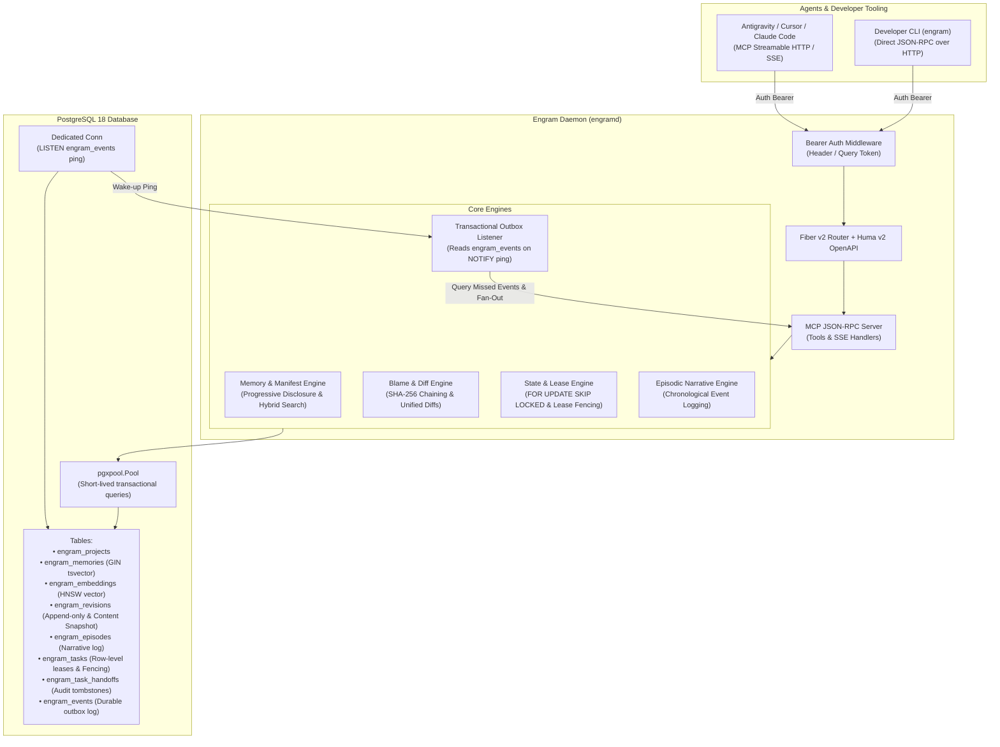
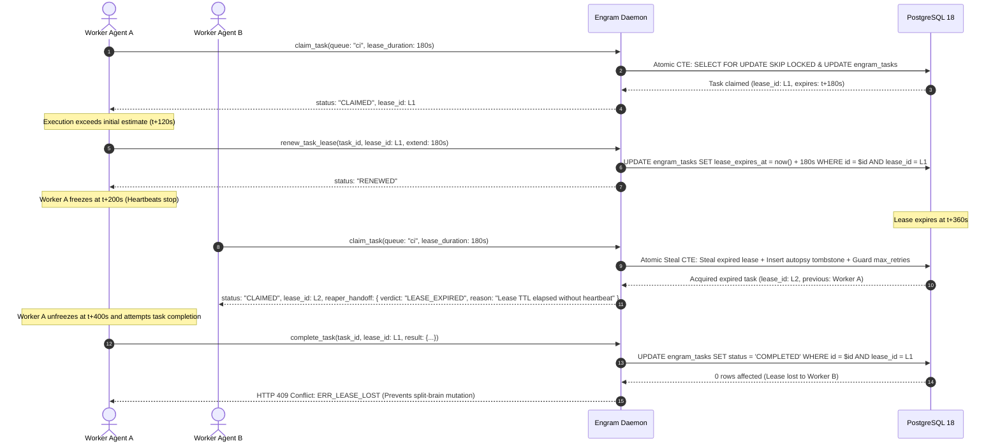

# Engram: Agentic Memory, Episodic Persistence & Multi-Machine Operational State Plane

* **Author:** Iván Salazar
* **Status:** Approved (Hardened via EGM Review)
* **Date:** 2026-11-23

--------------------------------------------------------------------------------

## Overview

Engram is a self-contained, high-performance service providing agentic memory, episodic/semantic persistence, and a concurrent operational state plane for AI coding agents (Antigravity, Claude Code, Cursor, Codex) and human software engineers. Communicating natively over the Model Context Protocol (MCP) via Streamable HTTP/SSE and a standardized developer CLI, Engram centralizes and coordinates state across heterogeneous developer machines (e.g., local MacBook, remote VPS, CI runners).

By replacing raw Markdown files committed to Git (`TODO.md`, `.serena/memories/*.md`, `checamos-docs/`), Engram prevents context window saturation through skeletal progressive disclosure, eliminates merge clobbering via optimistic content-hash concurrency, provides cryptographic blame trails, and coordinates concurrent execution via row-level atomic leases.

## The Problem

Modern AI-assisted engineering workflows rely heavily on flat Markdown files committed to Git or dumped into local working trees to track instructions, architectural constraints, and task progress. This introduces four acute failure modes:

1. **Severe Context Window Saturation:** Agents dump complete documentation or state files on every prompt invocation. Typical raw memory dumps consume 4,000–8,000 tokens per invocation, displacing active task code and inducing attention drift.
2. **Silent State Clobbering & Git Merge Conflicts:** When multiple agents or developers run concurrently across branches or physical machines, concurrent writes to `TODO.md` or memory files create unresolvable Git merge conflicts or overwrite each other's state without notice.
3. **Zero Cross-Machine Visibility:** Background processes, remote VPS environments (Contabo), and local machines have no shared, live synchronization of in-flight task execution, leading to duplicate or contradictory work.
4. **Lack of Provenance and Blame:** Markdown files do not record which agent model, user, or machine made specific rule changes or with what engineering rationale, making audit and debugging impossible when memories drift or regress.

Engram resolves these limitations by offering a transactional, centralized store exposed via standard MCP endpoints, enforcing progressive disclosure (manifest first, content on demand), atomic leases (`SKIP LOCKED`), and append-only cryptographic provenance.

## Goals

* **G1: Progressive Disclosure Manifests:** Expose lightweight skeletal manifests (`key`, one-line `digest`, `token_count`, `scope`) that allow agents to discover existing memories and guidelines using <1,500 tokens across 100 entries. Full content hydration is strictly deferred until requested.
* **G2: Cryptographic Blame & Provenance:** Every memory write is append-only, capturing author, agent model, machine ID, task ID, engineering rationale, full content, a unified diff against its predecessor, and a verifiable SHA-256 parent hash chain.
* **G3: Strict Optimistic Concurrency Control (OCC):** Provide optimistic hash validation (`expected_parent_hash`). When concurrent edits collide, reject stale writes with HTTP 409 Conflict (`ERR_STALE_REVISION`) returning actionable diffs and current HEAD to the invoking agent, ensuring a strictly linear and monotonic revision ledger.
* **G4: Concurrent Operational State Plane:** Manage queues of tasks and worker leases using row-level locking (`FOR UPDATE SKIP LOCKED`) and lease fencing tokens (`lease_id`). Expired leases are atomically reclaimable with poison-pill guards (`max_retries`) and automatically documented via system autopsy handoffs.
* **G5: Dual MCP & CLI Parity:** Support streamable HTTP and SSE transports authenticated by pre-shared Bearer tokens, fully compatible with Antigravity, Claude Code, and a dedicated developer CLI (`engram`).
* **G6: Resilient Dual-Tier Retrieval:** Combine deterministic English fulltext search (`tsvector` + `ts_rank` + `pg_trgm`) with optional vector similarity (`vector_cosine_ops`), gracefully degrading to fulltext search when embeddings are omitted.
* **G7: Durable Outbox Event Streaming:** Provide reliable real-time event streaming across network flaps and disconnections via a persistent transactional outbox (`engram_events`) and standard SSE `Last-Event-ID` replay.

## Non-Goals

* **NG1: General-Purpose Binary Object Store:** Engram does not store raw binaries, Docker images, or build artifacts. It stores text invariants, structured facts, and operational state pointers.
* **NG2: Direct Git Automation & In-Database Branching:** Engram acts as an independent operational state plane; it does not automatically commit or push Git branches to source repositories, nor does it maintain speculative multi-parent DAG branches inside database tables.
* **NG3: Public Multi-Tenant SaaS:** Engram is designed as a private, self-contained service operating over localhost or private mesh networks (Tailscale). Complex enterprise RBAC, multi-tenant billing, and OAuth2 identity providers are out of scope.
* **NG4: Scheduled Polling/Reaper Daemons:** Engram avoids external polling crons or background reaper daemons; task lease recovery and autopsy tombstones occur dynamically during atomic query execution. (Persistent event streaming listeners for SSE fan-out remain a standard architectural component).

## Critical User Journeys (CUJs)

### CUJ 1: Progressive Discovery and Hydration by an Autonomous Agent
* **Given**: An agent starts work on a repository with 50 persistent architectural memories stored in Engram.
* **When**: The agent calls `list_manifest(project_id: "birdple-v2")`.
* **Then**: Engram returns a compact skeletal array of keys, digests, and token counts consuming <800 tokens. The agent identifies the single relevant key (`auth/jwt-rotation`) and calls `get_memories_batch(["auth/jwt-rotation"])` to hydrate only the necessary rules.

### CUJ 2: Concurrent State Mutation with Optimistic Concurrency Control
* **Given**: Agent A (MacBook) and Agent B (VPS) inspect memory `core/database-schema` at revision hash `h_0`.
* **When**: Agent A updates the memory to hash `h_1`. Seconds later, Agent B attempts to update the memory specifying `expected_parent_hash: "h_0"`.
* **Then**: Engram rejects silent overwriting, checks `current_hash == "h_0"` (fails, current is `h_1`), and returns HTTP 409 Conflict (`ERR_STALE_REVISION`) with `head_rev: 2`, `head_hash: "h_1"`, current HEAD content, and a unified diff. Agent B reconciles the diff in its context and resubmits targeting `h_1`.

### CUJ 3: Task Lease Claim, Fencing and Poison-Pill Recovery
* **Given**: Task `task-402` is claimed by Agent A with lease `L1` (TTL: 180s). Agent A freezes or crashes at $t=30\text{s}$.
* **When**: Lease expires at $t=180\text{s}$, and Agent B calls `claim_task()`.
* **Then**: The query atomically acquires the expired task using an atomic CTE with `SKIP LOCKED`, assigns it new lease `L2`, increments `claim_count`, and writes an autopsy tombstone in `engram_task_handoffs` (`from_agent: "system/lease-reaper"`, `verdict: "LEASE_EXPIRED"`). If Agent A later awakens and attempts `complete_task(task_id, lease_id: L1)`, the lease fencing check (`WHERE lease_id = L1`) fails with HTTP 409 Conflict (`ERR_LEASE_LOST`), preventing split-brain corruption.

### CUJ 4: Episodic Event Logging during Session Handoff
* **Given**: Agent A completes an autonomous refactor milestone and prepares to yield execution.
* **When**: Agent A calls `log_episode(session_id: "sess-88", actor: "antigravity", event_type: "MILESTONE", summary: "Migrated auth middleware to strict Bearer tokens", details: { files: [...] })`.
* **Then**: Engram appends the event to `engram_episodes`, indexes its summary into `tsv` via GIN, and broadcasts a durable outbox event for any connected developer CLI or webhooks.

### CUJ 5: Dual-Tier Hybrid Search Fallback
* **Given**: An agent queries `search_memories(query: "jwt rotation policy")` in a project where vector embeddings have not been configured.
* **When**: The query executes against Engram.
* **Then**: Engram detects that vector cosine ranking is unavailable for the project, transparently executes fulltext search using `tsvector` with `ts_rank` and trigram similarity over `key`, and returns ranked results with highlighted snippets without throwing an error.

### CUJ 6: Blame Traversal & History Inspection
* **Given**: A developer observes an unexpected change in memory `infra/deployment-ports`.
* **When**: The developer runs `engram blame infra/deployment-ports`.
* **Then**: Engram returns the complete chronological revision history: revision numbers, SHA-256 hashes, parent hashes, author names, agent models, machine IDs, rationale, and exact unified diffs, cryptographically verifying each link in the hash chain.

--------------------------------------------------------------------------------

## Technical Plan (Architecture)

### 1. System Topology & Component Model

Engram is deployed as a single self-contained binary daemon (`engramd`) paired with a developer CLI (`engram`), backed by a PostgreSQL 18 instance with `pgvector` and `pg_trgm` extensions. Agents connect over localhost or a private mesh network (Tailscale) using standard Model Context Protocol (MCP) transports.



### 2. Concrete Data Model & Relational Schema (DDL)

To eliminate vector dimension rigidity, decouple persistent reference knowledge from episodic session logs, and prevent SSE connections from exhausting the database pool, the relational schema in PostgreSQL 18 is partitioned as follows:

```sql
-- Extensions
CREATE EXTENSION IF NOT EXISTS "uuid-ossp";
CREATE EXTENSION IF NOT EXISTS "pg_trgm";
CREATE EXTENSION IF NOT EXISTS "vector";

-- 1. Projects (Isolated context namespaces)
CREATE TABLE engram_projects (
    id TEXT PRIMARY KEY,
    name TEXT NOT NULL,
    description TEXT NOT NULL DEFAULT '',
    created_at TIMESTAMPTZ NOT NULL DEFAULT now()
);

-- 2. Canonical Reference Memories (Progressive Disclosure Core)
CREATE TABLE engram_memories (
    project_id TEXT NOT NULL REFERENCES engram_projects(id) ON DELETE CASCADE,
    key TEXT NOT NULL,
    current_hash TEXT NOT NULL,
    head_rev INT NOT NULL DEFAULT 1,
    title TEXT NOT NULL,
    digest TEXT NOT NULL,
    scope TEXT NOT NULL DEFAULT 'global',
    content TEXT NOT NULL,
    token_count INT NOT NULL DEFAULT 0,
    metadata JSONB NOT NULL DEFAULT '{}'::jsonb,
    tsv TSVECTOR GENERATED ALWAYS AS (
        setweight(to_tsvector('english', coalesce(title, '')), 'A') ||
        setweight(to_tsvector('english', coalesce(key, '')), 'B') ||
        setweight(to_tsvector('english', coalesce(content, '')), 'C')
    ) STORED,
    created_at TIMESTAMPTZ NOT NULL DEFAULT now(),
    updated_at TIMESTAMPTZ NOT NULL DEFAULT now(),
    PRIMARY KEY (project_id, key)
);

CREATE INDEX idx_engram_memories_tsv ON engram_memories USING GIN(tsv);
CREATE INDEX idx_engram_memories_trgm_key ON engram_memories USING GIN(key gin_trgm_ops);
CREATE INDEX idx_engram_memories_scope ON engram_memories(project_id, scope);

-- 3. Auxiliary Model-Specific Vector Projections
CREATE TABLE engram_embeddings (
    id UUID PRIMARY KEY DEFAULT gen_random_uuid(),
    project_id TEXT NOT NULL,
    memory_key TEXT NOT NULL,
    model TEXT NOT NULL,
    dimensions INT NOT NULL,
    embedding_1536 VECTOR(1536),
    embedding_768 VECTOR(768),
    created_at TIMESTAMPTZ NOT NULL DEFAULT now(),
    CONSTRAINT fk_memory FOREIGN KEY (project_id, memory_key)
        REFERENCES engram_memories(project_id, key) ON DELETE CASCADE,
    CONSTRAINT uq_memory_model UNIQUE (project_id, memory_key, model)
);

CREATE INDEX idx_engram_embeddings_1536 ON engram_embeddings 
    USING hnsw (embedding_1536 vector_cosine_ops) WHERE embedding_1536 IS NOT NULL;
CREATE INDEX idx_engram_embeddings_768 ON engram_embeddings 
    USING hnsw (embedding_768 vector_cosine_ops) WHERE embedding_768 IS NOT NULL;

-- 4. Cryptographic Blame & Revisions (Append-Only Snapshot Ledger)
CREATE TABLE engram_revisions (
    project_id TEXT NOT NULL,
    key TEXT NOT NULL,
    rev INT NOT NULL,
    hash TEXT NOT NULL,
    parent_hash TEXT NOT NULL,
    author TEXT NOT NULL,
    agent_model TEXT NOT NULL,
    machine_id TEXT NOT NULL,
    content TEXT NOT NULL,
    diff TEXT NOT NULL DEFAULT '',
    rationale TEXT NOT NULL DEFAULT '',
    created_at TIMESTAMPTZ NOT NULL DEFAULT now(),
    PRIMARY KEY (project_id, key, rev),
    CONSTRAINT fk_revision_memory FOREIGN KEY (project_id, key)
        REFERENCES engram_memories(project_id, key) ON DELETE CASCADE
);

CREATE INDEX idx_engram_revisions_hash ON engram_revisions(project_id, key, hash);

-- 5. Episodic Event Log (Chronological Narrative Trail)
CREATE TABLE engram_episodes (
    id UUID PRIMARY KEY DEFAULT gen_random_uuid(),
    project_id TEXT NOT NULL REFERENCES engram_projects(id) ON DELETE CASCADE,
    session_id TEXT NOT NULL,
    event_type TEXT NOT NULL,
    actor TEXT NOT NULL,
    summary TEXT NOT NULL,
    details JSONB NOT NULL DEFAULT '{}'::jsonb,
    tsv TSVECTOR GENERATED ALWAYS AS (
        to_tsvector('english', coalesce(summary, ''))
    ) STORED,
    created_at TIMESTAMPTZ NOT NULL DEFAULT now()
);

CREATE INDEX idx_engram_episodes_session ON engram_episodes(project_id, session_id, created_at DESC);
CREATE INDEX idx_engram_episodes_tsv ON engram_episodes USING GIN(tsv);

-- 6. Concurrent Operational Tasks & Leases
CREATE TABLE engram_tasks (
    id TEXT NOT NULL,
    project_id TEXT NOT NULL REFERENCES engram_projects(id) ON DELETE CASCADE,
    queue TEXT NOT NULL DEFAULT 'default',
    title TEXT NOT NULL,
    payload JSONB NOT NULL DEFAULT '{}'::jsonb,
    status TEXT NOT NULL DEFAULT 'PENDING' 
        CHECK (status IN ('PENDING', 'CLAIMED', 'COMPLETED', 'FAILED', 'BLOCKED')),
    priority INT NOT NULL DEFAULT 0,
    claimed_by TEXT,
    lease_id UUID,
    claimed_at TIMESTAMPTZ,
    lease_expires_at TIMESTAMPTZ,
    claim_count INT NOT NULL DEFAULT 0,
    max_retries INT NOT NULL DEFAULT 3,
    completed_at TIMESTAMPTZ,
    result JSONB,
    created_at TIMESTAMPTZ NOT NULL DEFAULT now(),
    updated_at TIMESTAMPTZ NOT NULL DEFAULT now(),
    PRIMARY KEY (project_id, id)
);

CREATE INDEX idx_engram_tasks_pending ON engram_tasks(project_id, queue, priority DESC, created_at ASC)
    WHERE status = 'PENDING';
CREATE INDEX idx_engram_tasks_expired ON engram_tasks(project_id, queue, lease_expires_at)
    WHERE status = 'CLAIMED';

-- 7. Task Handoff & Diagnostic Tombstones
CREATE TABLE engram_task_handoffs (
    id UUID PRIMARY KEY DEFAULT gen_random_uuid(),
    project_id TEXT NOT NULL,
    task_id TEXT NOT NULL,
    from_agent TEXT NOT NULL,
    to_agent TEXT NOT NULL,
    verdict TEXT NOT NULL CHECK (verdict IN ('PASS', 'FAIL', 'BLOCKED', 'NEEDS_REVIEW', 'HANDOFF', 'LEASE_EXPIRED')),
    reason TEXT NOT NULL,
    metadata JSONB NOT NULL DEFAULT '{}'::jsonb,
    created_at TIMESTAMPTZ NOT NULL DEFAULT now(),
    CONSTRAINT fk_task_handoff FOREIGN KEY (project_id, task_id)
        REFERENCES engram_tasks(project_id, id) ON DELETE CASCADE
);

CREATE INDEX idx_engram_task_handoffs_task ON engram_task_handoffs(project_id, task_id, created_at DESC);

-- 8. Durable Transactional Outbox (Reliable SSE Event Stream)
CREATE TABLE engram_events (
    id BIGSERIAL PRIMARY KEY,
    project_id TEXT NOT NULL REFERENCES engram_projects(id) ON DELETE CASCADE,
    topic TEXT NOT NULL,
    payload JSONB NOT NULL,
    created_at TIMESTAMPTZ NOT NULL DEFAULT now()
);

CREATE INDEX idx_engram_events_stream ON engram_events(project_id, id ASC);
```

### 3. Critical Data Flows & Sequence Diagrams

#### Sequence 1: Progressive Disclosure (Discovery vs. Hydration)
Agents avoid saturating their prompt context by querying the catalog in two distinct steps.

```mermaid
sequenceDiagram
    autonumber
    actor Agent as AI Agent (MCP Client)
    participant Engram as Engram Daemon (engramd)
    participant DB as PostgreSQL 18

    Note over Agent, DB: Phase 1: Progressive Discovery (<1,500 tokens)
    Agent->>Engram: list_manifest(project_id: "engram", scope: "arch")
    Engram->>DB: SELECT key, digest, token_count, scope FROM engram_memories WHERE project_id = $1
    DB-->>Engram: Skeletal records
    Engram-->>Agent: JSON array of keys & digests (Zero fulltext dumping)

    Note over Agent, DB: Phase 2: Explicit Batch Hydration
    Agent->>Agent: Inspects keys; selects only needed items
    Agent->>Engram: get_memories_batch(project_id: "engram", keys: ["arch/outbox"])
    Engram->>DB: SELECT * FROM engram_memories WHERE project_id = $1 AND key = ANY($2)
    DB-->>Engram: Full content & hashes
    Engram-->>Agent: Hydrated memory content
```

#### Sequence 2: Optimistic Mutation with Strict Concurrency Control (OCC)
When parallel agents edit the same key, Engram enforces parent hash validation and rejects stale writes without silent clobbering, returning unified diffs for local reconciliation.

```mermaid
sequenceDiagram
    autonumber
    actor A1 as Agent 1 (MacBook)
    actor A2 as Agent 2 (VPS)
    participant Engram as Engram Daemon
    participant DB as PostgreSQL 18

    A1->>Engram: store_memory(key: "auth", expected_parent_hash: "h0", content: "C1")
    Engram->>DB: Verify current_hash == "h0" -> True
    Engram->>DB: In TX: Append rev 2 (hash: "h1", parent: "h0"), update head to "h1", write engram_events outbox
    Engram->>DB: NOTIFY engram_events, 'ping'
    Engram-->>A1: status: "STORED", rev: 2, hash: "h1"

    A2->>Engram: store_memory(key: "auth", expected_parent_hash: "h0", content: "C2")
    Engram->>DB: Verify current_hash == "h0" -> False (current is "h1")
    Note over Engram, DB: Strict Optimistic Concurrency Rejection (409 Conflict)
    Engram->>DB: Fetch current HEAD ("h1", content "C1")
    Engram->>Engram: Compute unified diff between C1 and C2
    Engram-->>A2: HTTP 409 / ERR_STALE_REVISION: { head_rev: 2, head_hash: "h1", current_content: "C1", diff_unified: "@@ ...", message: "Stale revision; reconcile against HEAD" }
    Note over A2: Reconciles changes in local context window
    A2->>Engram: store_memory(key: "auth", expected_parent_hash: "h1", content: "C_merged")
    Engram->>DB: In TX: Append rev 3 (hash: "h2", parent: "h1"), update head to "h2", write engram_events outbox
    Engram-->>A2: status: "STORED", rev: 3, hash: "h2"
```

#### Sequence 3: Atomic Task Leases, Fencing & Reaper Autopsy
Task acquisition uses row-level locks, allows heartbeats during long runs, prevents split-brain mutations via lease fencing tokens (`lease_id`), and guards against poison pills (`max_retries`).



### 4. SSE Connection Management, Durable Outbox & Pool Starvation Protection

To guarantee that long-lived streaming connections do not exhaust the short-lived query connection pool, violate PostgreSQL 8KB payload limits, or drop events during transient network partitions:

1. **Transactional Outbox Table (`engram_events`):** Every database mutation (`store_memory`, `claim_task`, `complete_task`) inserts an event row into `engram_events` (`id BIGSERIAL, project_id, topic, payload JSONB`) within the same `pgx.Tx` transaction, followed by a zero-payload wake-up ping (`NOTIFY engram_events, 'ping'`). This completely eliminates PL/pgSQL triggers, bypasses PostgreSQL's 8,000-byte ceiling, and ensures persistent event durability across daemon restarts.
2. **Dedicated Outbox Listener Worker:** A single persistent `pgx.Conn` executes `LISTEN engram_events`. Upon receiving a wake-up ping, it queries `SELECT * FROM engram_events WHERE id > $last_seen_id ORDER BY id ASC` and fans out the event records to in-memory subscriber channels.
3. **Resilient SSE Replay (`Last-Event-ID`):** Active SSE connections (`GET /sse`) register to an in-memory channel. Upon connection or reconnection, clients provide the standard `Last-Event-ID: N` header. The server streams all missed events `WHERE id > N` directly from `engram_events` before streaming live events, guaranteeing at-least-once delivery across Tailscale reconnects and network flaps.
4. **Secure Ephemeral Ticket Handshake:** To prevent leaking long-lived Bearer tokens in URL query strings (`?token=`), EventSource clients first request an ephemeral single-use ticket:
   - `POST /api/v1/sse/ticket` with `Authorization: Bearer <secret>` returns `{ "ticket": "<uuid>", "expires_in": 30 }`.
   - The client opens `GET /sse?ticket=<uuid>`, which is validated and invalidated atomically in memory. Standard Bearer headers remain supported.
5. **Pool Isolation:** All MCP tool calls, REST queries, and transactions continue using `pgxpool.Pool` for immediate sub-millisecond checkout and release.

--------------------------------------------------------------------------------

## Alternatives Considered

### Alternative 1: Flat Markdown Files in Git Repositories (`TODO.md`, `.serena/memories/*.md`)

* **Pros:** Zero external infrastructure dependencies; native versioning via Git; human-readable text inspectable directly in IDE editors.
* **Cons:** High token consumption on greedy directory reads; continuous Git merge conflicts when multiple agents work on parallel branches; zero live state visibility across physically separate environments (e.g., local laptop vs. remote build server).
* **Reason for Rejection:** `Rejected by author: Saturates LLM context windows with static text and creates frequent git merge conflicts during parallel agent execution.`

### Alternative 2: Valkey / Redis with RedisJSON and RediSearch

* **Pros:** Microsecond read latency; built-in pub/sub primitives; simple key-value semantics.
* **Cons:** Requires complex Redis Stack or enterprise modules for vector search; lacks multi-table transactional consistency across task handoffs and revisions; does not support relational foreign-key integrity or built-in unified diff generation.
* **Reason for Rejection:** `Rejected by author: Insufficient relational guarantees for audit blame chains and lacks native hybrid vector plus fulltext indexing.`

### Alternative 3: Embedded SQLite with Litestream Replication

* **Pros:** Single embedded file with zero client-server daemon management; ultra-lightweight development environment.
* **Cons:** Ineffective for real-time multi-machine synchronization (MacBook, VPS Contabo, CI runners); suffers write lock contention (`database is locked`) when multiple concurrent agent loops write simultaneously; lacks native vector indexing extensions across heterogeneous OS binaries without CGO complications.
* **Reason for Rejection:** `Rejected by author: Fails multi-machine synchronization across local workstation and remote VPS, with high lock contention under parallel agent writes.`

### Alternative 4: Third-Party Managed SaaS Memory Services (Mem0 Cloud, Pinecone, LangChain Hub)

* **Pros:** Fully hosted infrastructure with out-of-the-box management dashboards and zero ops burden.
* **Cons:** Violates strict data sovereignty by streaming proprietary codebase rules and operational state to third-party cloud infrastructure; introduces recurring SaaS subscription costs and external API network latency; completely lacks operational task queueing with row-level leases (`SKIP LOCKED`).
* **Reason for Rejection:** `Rejected by author: Violates data sovereignty for proprietary codebases, introduces external API failure modes, and lacks operational task lease coordination.`

### Alternative 5: Standalone Background Cron / Reaper Daemons for Task Leases

* **Pros:** Continuously scans the task queue to clear expired leases independent of incoming requests.
* **Cons:** Introduces a second process or container to manage, monitor, and keep healthy; introduces silent failure modes if the reaper crashes unnoticed; wastes CPU and I/O cycles polling idle databases.
* **Reason for Rejection:** `Rejected by author: Adds unneeded operational surface; dynamic atomic lease stealing via SQL FOR UPDATE SKIP LOCKED achieves immediate recovery with zero idle overhead.`

--------------------------------------------------------------------------------

## Detailed Implementation Plan

The implementation is broken into 5 sequential stages, detailing every touched file, its architectural rationale, and the specific modifications required. Actual code generation is deferred to the execution phase.

### Stage 1: Database Infrastructure & Canonical PostgreSQL 18 Schema

1. **`go.mod` & `go.sum`**
   - *Rationale:* Initializes Go 1.24+ module `github.com/ivan/engram` standardizing on canonical dependencies: `github.com/gofiber/fiber/v2`, `github.com/danielgtaylor/huma/v2`, `github.com/jackc/pgx/v5`, `github.com/pgvector/pgvector-go`, and `github.com/pmezard/go-difflib`. Strictly excludes Fiber v3.
2. **`internal/platform/config/config.go` & `.env.example`**
   - *Rationale:* Typed configuration struct parsing environment variables (`DATABASE_URL`, `ENGRAM_PORT`, `ENGRAM_AUTH_TOKEN`, `DEFAULT_LEASE_TTL`, `LOG_LEVEL`) with documented defaults and fail-fast validation.
3. **`docker-compose.yml`**
   - *Rationale:* Sets up the official PostgreSQL 18 container with `pgvector/pgvector:pg18` on local port 5433 to avoid port collisions with host databases. Includes health check and volume mounting for automated migration loading.
4. **`migrations/00001_initial_schema.sql`**
   - *Rationale:* Canonical DDL initializing PostgreSQL 18 extensions (`uuid-ossp`, `pg_trgm`, `vector`), creating partitioned tables (`engram_projects`, `engram_memories`, `engram_embeddings`, `engram_revisions`, `engram_episodes`, `engram_tasks`, `engram_task_handoffs`, `engram_events`), establishing GIN fulltext/trigram indexes, HNSW vector cosine indexes, and outbox stream indexes. Stores full `content` in revisions, enforces verdict check constraints, and splits task indexes for pending vs. expired claims.
5. **`sqlc.yaml`**
   - *Rationale:* Configures `sqlc` to generate type-safe Go code for PostgreSQL 18 using `pgx/v5`, mapping vector columns to `github.com/pgvector/pgvector-go.Vector` and enforcing JSON tag emissions.
6. **`internal/platform/db/db.go`**
   - *Rationale:* Initializes the shared `pgxpool.Pool` connection pool with configurable maximum connections, lifetime, and idle parameters.
7. **`internal/platform/db/migrate.go`**
   - *Rationale:* Reads and applies `.sql` migration files sequentially during daemon boot to ensure schema parity without manual DBA intervention.
8. **`internal/platform/db/listener.go`**
   - *Rationale:* Implements a dedicated background worker holding an isolated `pgx.Conn` executing PostgreSQL `LISTEN engram_events`. Upon receiving wake-up pings, it queries `engram_events` for new sequence IDs and fans out notifications to an in-memory channel registry, protecting `pgxpool.Pool` from SSE connection starvation.

### Stage 2: SQL Queries & Generated Code (sqlc)

9. **`internal/db/queries/projects.sql`**
   - *Rationale:* Queries for project namespace creation, lookup, and deletion.
10. **`internal/db/queries/memories.sql`**
    - *Rationale:* Implements skeletal manifest retrieval (`key`, `digest`, `token_count`, `scope`), batch memory hydration (`get_memories_batch`), optimistic hash checks, fulltext keyword search with `ts_rank` and trigram similarity, and dual-tier hybrid vector cosine ranking.
11. **`internal/db/queries/revisions.sql`**
    - *Rationale:* Queries for append-only audit trail inserts storing full `content` snapshot and `diff`, parent hash validation, and chronological history retrieval for blame inspection. Squashing queries are pruned (YAGNI).
12. **`internal/db/queries/tasks.sql`**
    - *Rationale:* Implements atomic CTE lease claims with `SKIP LOCKED`, poison-pill guards (`claim_count >= 3 -> FAILED`), lease heartbeats with fencing (`WHERE lease_id = $lease_id`), task completion, failure marking, and queue status listing.
13. **`internal/db/queries/handoffs.sql`**
    - *Rationale:* Queries for recording immutable agent handoff events and system reaper crash tombstones.
14. **`internal/db/queries/episodes.sql`**
    - *Rationale:* Queries for chronological narrative event logging and session-scoped fulltext search.
15. **`internal/db/queries/events.sql`**
    - *Rationale:* Queries for transactional outbox event insertion (`InsertEvent`) and missed event replay by sequence ID (`GetEventsAfter`) supporting `Last-Event-ID`.
16. **`internal/db/*.sql.go`** (generated by `sqlc`)
    - *Rationale:* Go structs, parameter types, and database execution methods generated from the SQL queries above.

### Stage 3: Core Domain Services & Invariant Enforcement

17. **`internal/core/memories/blame.go`**
    - *Rationale:* Implements canonical SHA-256 hash chaining using standardized preimage format (`parent:<hash>\nkey:<key>\nauthor:<author>\nmodel:<model>\nmachine:<id>\ncontent:\n<LF-content>`), unified diff generation via `github.com/pmezard/go-difflib/difflib`, and unbroken cryptographic chain verification.
18. **`internal/core/memories/service.go`**
    - *Rationale:* Business logic for progressive manifests, batch memory retrieval, strict OCC validation returning HTTP 409 Conflict (`ERR_STALE_REVISION`) with unified diff on collisions, hybrid search orchestration, and calibrated token estimation.
19. **`internal/platform/embedding/client.go`**
    - *Rationale:* Defines the `Embedder` interface with implementations for external providers (OpenAI API, Ollama/local HTTP) and a graceful No-Op fallback when embeddings are unconfigured.
20. **`internal/core/state/handoff.go`**
    - *Rationale:* Enforces the strict handoff contract: <150 words `reason`, valid verdict enum (`PASS`, `FAIL`, `BLOCKED`, `NEEDS_REVIEW`, `HANDOFF`, `LEASE_EXPIRED`), and non-empty reproducible evidence in `metadata`.
21. **`internal/core/state/service.go`**
    - *Rationale:* Manages task creation, atomic lease stealing via CTE, heartbeat renewals with lease fencing (`lease_id`), poison-pill termination, and automatic system reaper handoff generation.
22. **`internal/core/episodes/service.go`**
    - *Rationale:* Manages narrative timeline event recording (`session_id`, `actor`, `event_type`, `summary`, `details`) and chronological narrative retrieval decoupled from reference knowledge.

### Stage 4: Platform Middleware & MCP Protocol Server

23. **`internal/platform/auth/auth.go`**
    - *Rationale:* Fiber middleware enforcing constant-time Bearer token authentication via HTTP `Authorization` headers, and provides ephemeral single-use ticket generation (`POST /api/v1/sse/ticket` -> 30s TTL) for secure SSE client connections.
24. **`internal/platform/apierr/apierr.go`**
    - *Rationale:* Implements RFC 7807 Problem Details structured error formatting compatible with Huma v2.
25. **`internal/mcp/types.go`**
    - *Rationale:* JSON-RPC 2.0 protocol definitions and MCP capability schemas (tools, resources, prompts).
26. **`internal/mcp/tools.go`**
    - *Rationale:* Registers and dispatches all operational MCP tools: `list_manifest`, `get_memories_batch`, `search_memories`, `store_memory`, `blame_memory`, `create_task`, `claim_task`, `renew_task_lease`, `complete_task`, `fail_task`, `record_handoff`, `log_episode`, and `query_episodes`. Squashing tools are pruned.
27. **`internal/mcp/server.go`**
    - *Rationale:* Implements the MCP SSE streaming endpoint (`GET /sse`) supporting `Last-Event-ID: N` replay from `engram_events`, ticket validation, and JSON-RPC message dispatch (`POST /mcp/message`).

### Stage 5: Daemon, CLI Tooling & Test Harness

28. **`cmd/engramd/main.go`**
    - *Rationale:* Server daemon binary: parses configuration, establishes `pgxpool.Pool`, applies migrations, starts background PostgreSQL outbox listener worker, mounts Huma v2 OpenAPI routes and MCP endpoints, and handles graceful shutdown.
29. **`cmd/engram/main.go` & `cmd/engram/commands/`**
   - *Rationale:* Developer CLI binary using `github.com/spf13/cobra`: modular subcommands (`manifest`, `recall`, `search`, `store`, `blame`, `task`, `handoff`, `episode`) communicating with the daemon via `internal/client/client.go`.
30. **`internal/client/client.go`**
    - *Rationale:* Shared typed HTTP/JSON-RPC client for daemon communication used by CLI commands and integration tests.
31. **`internal/platform/testutil/testdb.go`**
    - *Rationale:* Test database connection harness: connects to `ENGRAM_TEST_DATABASE_URL` (PostgreSQL 18 on port 5433), runs migrations, and isolates test suites via transactional rollbacks.
32. **`internal/core/memories/blame_test.go`** & **`internal/core/memories/service_test.go`**
    - *Rationale:* Unit and integration tests asserting canonical SHA-256 calculation, diff generation, hash chain verification, and strict OCC conflict rejections.
33. **`internal/core/state/handoff_test.go`** & **`internal/core/state/service_test.go`**
    - *Rationale:* Unit and integration tests asserting handoff word count limits (<150 words), verdict validation, atomic task claims via `SKIP LOCKED`, heartbeat renewals, lease fencing rejection, and poison-pill termination.
34. **`internal/platform/auth/auth_test.go`**
    - *Rationale:* Tests Bearer header and ticket token authentication paths, timing attack resistance, and unauthorized rejections.
35. **`internal/mcp/server_test.go`**
    - *Rationale:* Tests MCP protocol initialization, ping, tool discovery, execution of all operational tools, and JSON-RPC error mapping.
